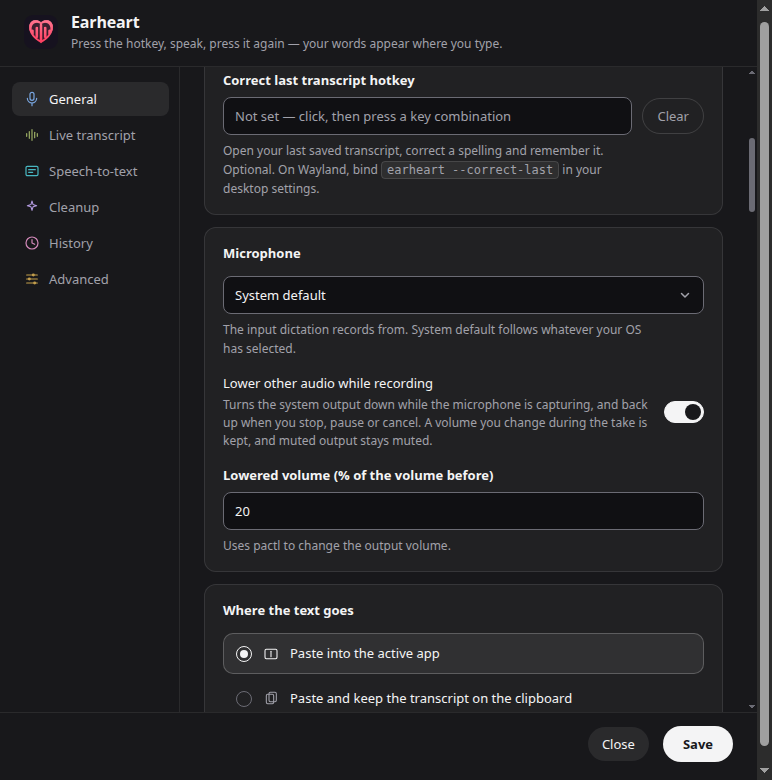
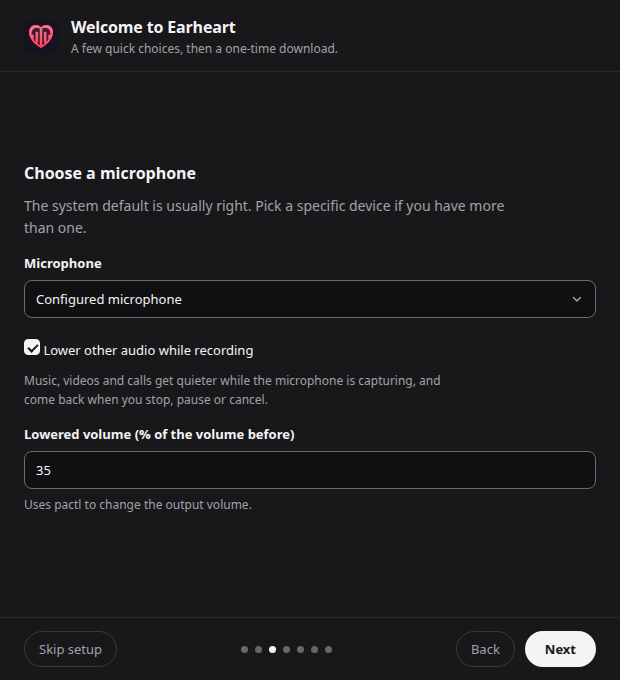

# Lower other audio while recording

Settings → General → Background audio → **Lower other audio while
recording** (off by default). While the microphone is capturing, Earheart
lowers the system output to a percentage of its volume before the take
(**Lowered volume**, default 20%, 0–80%), then puts it back. Issue #340.



The setup wizard offers the same choice on its microphone step (#365): the
checkbox and **Lowered volume** there are the same two settings
(`audio.duckOtherAudio`, `audio.duckLevelPercent`), with the same 0–80% range,
and show what is already saved when setup runs again. The step's status line
is the one Settings shows, so a system without a volume tool says so there and
setup continues; Finish setup saves the choice, and Settings shows it.



## What happens when

| Event | Effect |
| --- | --- |
| First samples arrive (the overlay says "Listening…") | output lowered |
| Pause | restored |
| Resume | lowered again |
| Stop, cancel, discard, microphone error, overlay crash | restored |
| Microphone unplugged mid-take (track ended) | restored; the take continues |
| Setting turned off mid-take | restored; turned on mid-take → lowered |
| Quit | restored before exit, within 2 s |
| Crash or forced kill | restored on the next launch (see *Recovery*) |

Opening the microphone is not enough: if the mic never delivers audio (a
permission prompt, a dead device), nothing is lowered.

## How fast it lowers

The lowering starts with the first samples, the moment the overlay says
"Listening…", and the volume drops in one step to the lowered level (no
fade). What stands between the two is the volume tool, so the tool is started
**at launch** (or when the setting is turned on), never at the first take, and
a take issues the set after a single read of the output (#369). A start
that fails for a reason that can pass (the audio server not up yet at login,
a PowerShell start that timed out) is tried again at the next take after
30 s; a tool that is not installed is not tried again:

| OS | Before the set | Measured (set issued after "Listening…") |
| --- | --- | --- |
| Linux | `pactl` default sink, then volume + mute in parallel (`wpctl`: inspect, get-volume) | pactl 11–12 ms, wpctl 17–20 ms (was 14–22 / 17–27 ms) |
| Windows | one request to the PowerShell helper, already running | not measured on a real machine yet |
| macOS | `system_profiler` (default device) alongside `osascript` (volume) | not measured on a real machine yet |

Linux was measured with `scripts/ducking-check.js` (below) on the machine
recorded there. Before #369, Windows started PowerShell and compiled the
Core Audio shim on every call — a probe, a read and a write before the volume
moved, ~1–2 s each — and macOS ran `system_profiler` twice (plus a probe on
the first take) before the set. Modelled with those per-call costs
(PowerShell 1.5 s, `system_profiler` 0.6 s, `osascript` 0.08 s), the set went
out after 3.0 s (4.5 s on the first take) on Windows and 1.4–1.5 s on macOS; now
10 ms and 0.7 s. macOS still pays one `system_profiler` run: it is the only
way to name the default device without a native module, and the restore
needs that name.

`test/ducking.test.js` pins this against stand-in tools with those cost
ratios: once prepared, exactly one device lookup precedes the set, and the
set goes out within two lookups' time on macOS and half a PowerShell start
on Windows (the old paths took about three lookups and two or more starts).

The Windows helper is one idle `powershell.exe` that stays running while
the setting is on; it stops when the setting is turned off and when Earheart
quits. If it hangs past the call timeout it is killed, and the next call
starts a fresh one. Its memory use is not measured yet.

## What is never overwritten

- **Muted output** stays muted, and its volume is never touched. Muting
  *during* a take is left as is (only the level is restored).
- **A volume you set during the take** is kept. The restore writes the prior
  volume only if the device still reads exactly the lowered level in the
  tool's own units (pactl's per-channel integers, wpctl's printed value,
  macOS's 0–100 integer, Windows' scalar). One step up or down counts as
  your change. A change you make in the instant between Earheart's set and
  its readback is yours too: the readback must match what was asked for
  exactly on Linux, within 0.0001 on Windows, within 3 points on macOS — or
  nothing is held.
  **Known limit (macOS):** macOS may snap the level to a device's hardware
  steps, so Earheart accepts a readback up to 3 points from what it set. A
  change of 1–3 points made by hand in the ~0.1 s between Earheart's set and
  its readback is taken as Earheart's own, and the restore overwrites it.
  Volume keys move 6.25 points and are never mistaken.
- **Another output device.** The restore addresses the device that was
  lowered, never whichever one is the default now. A device that has gone
  away is dropped without writing anywhere.
- **Overlapping sessions.** The controller counts owners: the output is
  lowered once, and restored only when the last capture lets go.

Nothing pauses media players, changes autoplay, or adjusts individual apps:
it is the system output's master volume, for the length of the capture.

## Per-OS mechanism

All commands run with `execFile` (argv, no shell), or on Windows through
the helper's stdin, with a timeout, in the background. A slow or failing tool
never delays a dictation.

| OS | Tool | Device identity | Notes |
| --- | --- | --- | --- |
| Linux | `pactl` (PulseAudio, or PipeWire through pipewire-pulse) | sink name | Preferred: keeps the per-channel balance. Run with `LC_ALL=C`. |
| Linux | `wpctl` (PipeWire/WirePlumber) | node id + `node.name` | Used when `pactl` is missing. Sets all channels to one level. |
| macOS | `osascript` (`get volume settings`, `set volume output volume`) | `system_profiler SPAudioDataType -json` default output (name + transport) | No permission prompt. osascript only reaches the default device, see below. The two run in parallel. |
| Windows | PowerShell + inline C# over Core Audio `IAudioEndpointVolume` | endpoint id | Default render endpoint, multimedia role. One long-lived helper: the shim compiles once (~1–2 s, at launch), then each request is a validated JSON line on stdin, answered in milliseconds. |

**macOS and device switches.** osascript can only change the *current
default* device. If you switch outputs during a take, Earheart does not
touch the new device; the original one stays lowered until it is the default
again, and is restored then (on the next take or launch) if it still sits at
the lowered level. Until then a new take does not lower anything, and
Settings says why.

osascript sets whichever device is the default when the set lands, and a
switch can land in the tens of milliseconds between Earheart's read and its
set:

- **During the restore**, the new output gets the old one's level. The
  readback names it, so Earheart keeps the marker and restores the original
  once it is back.
- **During the lowering**, the new output is lowered instead. Its level
  before was never read, so Earheart leaves it quiet rather than guess (the
  old output's level could be far too loud in headphones), and Settings says
  the output switched mid-lowering: set it back by hand.

Before #369 the same window existed, one `osascript` call later.

Two outputs with the same name on the same transport
(two identical USB DACs, say) can't be told apart, so with one of them as the
default nothing is lowered and Settings says so.

## Status in Settings

The line under the level field says what the feature can do here:
unavailable (and why — e.g. `pactl not found`), the last failure (e.g. access
denied), advice from the last take (macOS: the output switched mid-lowering,
kept until the next take starts), whether the last take was skipped (muted,
no volume control on the device), or which tool it uses. Dictation is the
same either way.

## Recovery

Before lowering, Earheart writes `audio-duck.json` to its user-data folder:
the tool, the device, the prior volume and the lowered one. It is removed
once the restore is settled. A marker found at launch is restored by the same
rule as above — only when that device still reads the lowered level — and
cleared; a marker from another tool, or older than 7 days, is cleared without
writing.

## Checking it by hand

`scripts/ducking-check.js` runs the real backend and controller (no Electron,
nothing persisted): it starts the tool, lowers the default output twice,
restores it, and prints the volume at each step. It also prints how long
starting the tool took, and for each take how long from the first samples
until the set was issued and confirmed. It exits 1 if the volume after
differs from the one before. Play some audio to hear it.

```sh
node scripts/ducking-check.js                 # 20%, first take held 3 s
node scripts/ducking-check.js --level=50 --hold=5
node scripts/ducking-check.js --backend=wpctl  # Linux: force wpctl
```

Recorded on Linux 6.17, PipeWire 1.6.2 (`pactl 17.0`, dummy `auto_null` sink),
2026-11-04:

| Run | Before | Lowered | After |
| --- | --- | --- | --- |
| pactl | `[65536,65536]` (100%) | `[13107,13107]` (20%) | `[65536,65536]` |
| wpctl | `1.00` | `0.20` | `1.00` |
| pactl, sink muted | 100%, muted | untouched ("output is muted, left as is") | 100%, muted |
| pactl, set to 45% mid-take | 100% | 20% | 45% kept ("left the volume as is (changed)") |

Timing, same machine, 2026-11-07 (#369): pactl started in 8 ms, set issued
11 / 12 ms after the first samples (takes 1 / 2), confirmed at 23 / 24 ms;
wpctl started in 17 ms, set issued 20 / 17 ms, confirmed at 44 / 44 ms.

**macOS and Windows: needs manual verification.** On each:

1. Play audio. Run `node scripts/ducking-check.js --hold=5` from a checkout
   (`make install` first). Expect `backend: osascript` / `backend: powershell`,
   the volume dropping to ~20% for 5 s, then `OK: restored to the volume
   before`. Note the `tool started in` and both `set issued … ms` lines: on
   Windows the takes should be tens of milliseconds (the start is the slow
   part, paid once); on macOS about one `system_profiler` run.
2. Mute the output, run it again: expect `not lowered: output is muted` and
   the output still muted afterwards.
3. Run with `--hold=10` and move the volume slider during the hold: expect the
   level you set to stay (the script prints `FAIL: volume differs`, which is
   the expected outcome here).
4. In the app: turn on the setting, start a dictation with audio playing,
   pause (audio comes back), resume (lowered again), stop (back).
5. Switch output devices during a take (e.g. speakers → headphones): the new
   device is not changed; on Windows the original is restored on stop; on
   macOS it is restored once it is the default again.
6. Start a take, then kill Earheart from Activity Monitor / Task Manager;
   relaunch: the output comes back.
