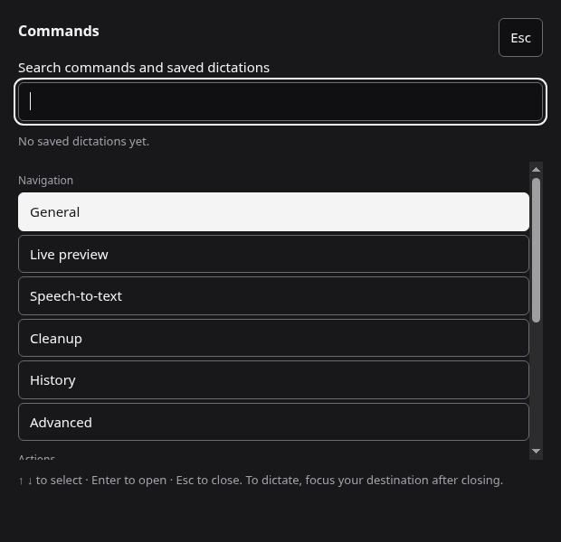

# Commands

Open **Commands…** in the tray or Settings, press **Ctrl+K** in Settings
(**Cmd+K** on macOS), or use the default global shortcut **Ctrl+Shift+K**
(**Cmd+Shift+K** on macOS). Settings → General → Commands hotkey lets you
capture another binding; Clear disables the global binding. If registration
fails, its field says why and the previous binding remains saved. Tray,
Settings and `earheart --palette` still work, including desktop bindings on
Wayland. A binding cannot take a dictation, pause, discard or correction key;
clear and save an old binding before transferring its key to Commands.

Type to filter Navigation and Actions. Up/Down selects, Home/End selects the
first/last available result, and Enter runs it once. Tab moves between search
and Close; Escape closes. Disabled commands stay labelled. Failures appear in
the status line; close and reopen to retry. Opening Commands again brings the
same window forward.

Navigation opens General, Live preview, Speech-to-text, Cleanup, History or
Advanced in the existing Settings window, preserving unsaved fields. Actions
reuse Copy last transcription, Correct last transcription, Check for updates
and Open error log. Copy includes a newer undelivered transcript even when
History is disabled, respects Deliver as one line and settles pending
clipboard restoration. Copy never pastes into another app.

History shows at most eight recent entries with an empty search. A query
matches saved text or the original transcript before cleanup, using History's
case-insensitive Unicode normalization and all-terms matching. Queries are
limited to 200 characters. The result count and Open History lead to the full
paged search. Enter on an entry opens that query and focuses the selected
card, including entries beyond the first page. If it has been removed, the
palette says so; History also handles entries removed during navigation.
History retains its Copy, Correct and explicitly confirmed Delete controls.
Commands adds no deletion, recording or model-management actions.

Commands opens only while dictation is idle, including no pending retry. It
refuses opening during microphone startup, recording, pause, processing or
delivery, and does not queue an opening for later. Pressing record or retry
while Commands is opening or open closes it and does nothing else. Focus your
destination and press the dictation key again. This prevents a focusable
palette from becoming a take's delivery destination. First-run setup keeps
precedence over Commands.

Escape restores an existing Earheart window's focused control. For an
external caller the palette closes without bringing Settings or the overlay
forward; foreground restoration is left to the OS. Deliberately focus the
intended destination before dictating. The palette has a separate preload
role: bounded search and fixed commands only, with sender checks in main;
the overlay gets no new Settings or History capabilities.

## Validation

`make test` covers dispatch, sender rejection, loading/busy/retry races,
fixed commands, deletion, duplicate activation, every hotkey collision and
save rollback. `make settings-smoke` drives the real palette with Chromium
keyboard events and checks focus, selected History cards, unsaved edits,
markup-shaped text, delayed search replies and both themes. `make screenshots`
regenerates the illustrations from an isolated demo profile.

Native release acceptance still needs an external text editor on macOS,
Windows, Linux X11 and Wayland: Escape restores the editor; busy open never
changes focus; record/retry while open only dismisses; and a later deliberate
dictation reaches the selected editor once. Headless Chromium tests do not
prove OS foreground restoration or paste delivery. These native environments
remain unverified by this implementation session; three-platform PR CI also
runs after the build step.
