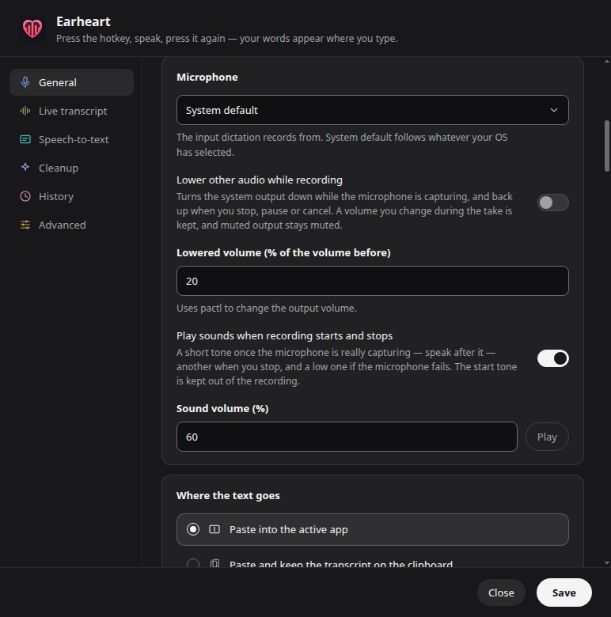

# Sounds when recording starts and stops

Settings → General → Microphone → **Play sounds when recording starts and
stops** (off by default). With it on, Earheart plays a short tone when the
microphone is really capturing, another when a take stops, and a lower one
when the microphone fails. **Sound volume** sets their level (default 60%,
5–100%); **Play** previews the start and stop tones. Issue #341.

The tones are synthesized in the overlay with Web Audio
([renderer/record-cues.js](../renderer/record-cues.js)): no sound files, no
network, nothing to download. Start and stop are two rising or falling notes,
100 ms each; the error tone is two lower notes, 225 ms, so a failure never
sounds like either.

## What plays when

| Event | Tone |
| --- | --- |
| First audio samples arrive from the microphone | start |
| Stop (hotkey, Done, maximum length reached) | stop, after the microphone is closed |
| Stop while the start tone is still playing | the start tone is cut, stop plays; nothing was recorded, so the attempt is abandoned like a stop before the mic was live |
| Stop before the microphone delivered any audio | none |
| Microphone permission denied, device missing, or no audio within 10 s | error |
| Microphone unplugged mid-take (track ended) | error; the take continues and stop still delivers what was captured, without a stop tone |
| Cancel, ✕, discard hotkey | none, and a tone still playing is cut |
| Pause and resume | none |
| A new dictation while a tone plays | the old tone is cut |

A tone needs real samples to play, so a start that fails — a permission
prompt, a dead device — never sounds like success. Only one tone sounds at a
time.

Setting changes apply from the next dictation.

## Keeping the start tone out of the recording

The start tone plays while the microphone is already open — that is what makes
it a true "you are being heard" signal — so the microphone hears it too. The
overlay drops it before the take begins:

1. The audio worklet tags every batch of samples with its capture frame on the
   recording context's clock.
2. The start tone is scheduled on that same context, so its end is a known
   point on the same timeline.
3. Every sample captured before *tone end + output latency + input latency +
   50 ms* is dropped. Latencies come from the context (`outputLatency`,
   `baseLatency`) and the microphone track (`latency`); a value the platform
   does not report counts as 300 ms (output) or 50 ms (input), so an unknown
   output path errs toward dropping more, never toward letting the tone in.
   There is no upper limit: a slow (Bluetooth) output path lengthens the guard.
4. Only then does the card say **Listening…**, the timer start, and other
   audio get lowered (if that is on). The live transcript, the saved recording
   and the transcribed take all start after the tone.

Because the cut is by capture position, not by when samples reach the page, a
busy renderer that delivers samples late or in a burst cuts at exactly the
same place.

**Speak after the tone.** A word started while it plays loses its beginning —
typically 150–250 ms on built-in speakers, more on Bluetooth. That is the cost
of a tone that only plays once capture is proven.

If a tone cannot play (no output device, an audio error), nothing is dropped
and the dictation works as it does with sounds off.

## Interaction with other settings

- **Lower other audio while recording**: lowering starts after the start tone,
  so the start tone plays at full volume. The stop tone plays as the output is
  being restored, so it may play at the lowered level — and is silent at 0%.
- **Echo cancellation** stays on; it may soften the tones in the microphone,
  but the drop above does not rely on it.

## Checking it by hand

Headless CI cannot listen, so these are manual:

1. Built-in mic and speakers: one rising tone before "Listening…", one falling
   tone on stop; none with the setting off.
2. Deny microphone permission, or unplug the selected mic before starting:
   only the low tone.
3. Double-press the hotkey quickly: silence, or start then stop — never two
   starts.
4. With History → keep recordings on, dictate with the speakers loud and play
   the kept recording: no tone at its start.
5. Bluetooth headset: repeat 1 and 4.
6. Unplug a USB mic mid-take: the low tone; stop still delivers the take.
7. Lower other audio at 20%: start tone at full volume, stop tone lower.
